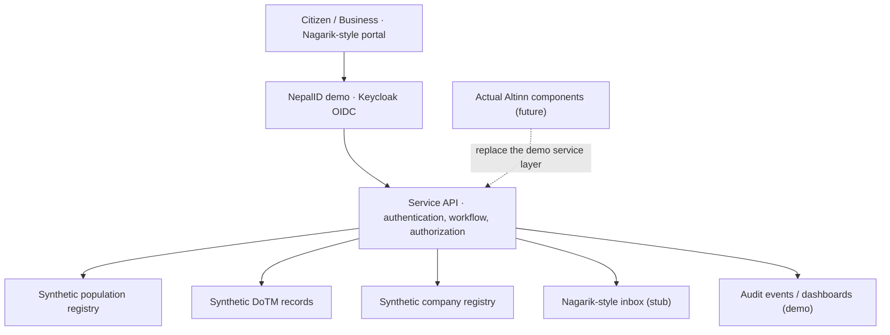

# Nepal Digital Services — Altinn Ecosystem Demonstrator 🇳🇵

**One login. Reusable services. Visible permissions. Connected government.**

Two complementary prototypes: a native Altinn App exercised through LocalTest and a standalone visual sandbox for conversations about **Altinn platform concepts** within Nepal's existing digital government ecosystem. It shows how Nagarik App, national identity, civil and business registries, and the Department of Transport Management could connect to a common application platform.

> **Honest scope:** The `native-altinn/` directory contains real Altinn application source running against LocalTest emulators, while `docker-compose.yml` still starts an Altinn-inspired sandbox. Neither is a deployed copy of all Norway's national platform services or an official Nepal government application. The OIDC authentication flow is real, using local Keycloak with synthetic users. Government registry APIs, the Nagarik inbox, authorization, workflow runtime, audit log, and Altinn adapter are local demonstration implementations or placeholders. No production government systems are accessed.

## Native Altinn application — recommended technical demonstration

A **genuine Altinn Studio v8 .NET App** lives in
[`native-altinn/nepal-licence`](native-altinn/nepal-licence/README.md).
It has the native Altinn runtime, BPMN process, data model,
Altinn UI, XACML policy, and native `IInstantiationProcessor` with
a replaceable, **synthetic** DoTM registry adapter.

Prerequisites: **.NET 10 SDK**, Docker/Podman/Colima, and the official
[`studioctl` CLI](https://docs.altinn.studio/en/altinn-studio/v8/guides/development/local-dev/).

```bash
# First install studioctl using the official documentation linked above.
bash scripts/start-native.sh
```

Visit **http://local.altinn.cloud:8000** and use LocalTest test identities.
The separate sandbox Keycloak users cannot authenticate to the native app.

**Actual:** Altinn App runtime, process, UI, form model, instantiation hook and XACML policy.
**Emulated:** shared Altinn Storage/Authentication/Authorization/Register/Profile via LocalTest.
**Not connected:** Nepal eID, Nagarik App, DoTM live registry, full national Altinn microservices.
See the [component-status matrix](docs/ALTINN_COMPONENT_STATUS.md).

## Presentation sandbox — separate illustrative experience

The following Docker Compose stack remains a **standalone simulator** for the
multi-role story, not the native Altinn runtime. Its delegations, officer
workflows and inbox are not yet connected to the native application.

## Start the presentation sandbox

Prerequisite: Docker Engine / Docker Desktop with Docker Compose (v2).

```bash
git clone https://github.com/SushantGautam/altinn-example-np.git
cd altinn-example-np
docker compose up --build -d
```

Open **http://localhost:8000**. The local identity-provider login opens at **http://localhost:8081**. Initial Keycloak startup may take a little longer than the portal. If login temporarily fails, check `docker compose logs -f identity` and retry after the provider is ready.

All users share the **local demo-only password: `Demo123!`**:

| Username | Role | What to demonstrate |
|---|---|---|
| `asha` | Citizen | Prefilled licence-correction application; inbox; result |
| `maya` | DoTM officer | View agency queue; approve / request info / reject |
| `raj` | Company director | Grant/revoke scoped company access |
| `priya` | Accountant | Submit on behalf of company only with an active grant |
| `kiran` | Government observer | Inspect metrics, architecture and audit; reset scenario |

Use **Switch demo identity** (in the left navigation), then sign in again with the next user's credentials. Each login uses a real OIDC authorization-code flow with PKCE, an ID-token signature check, state, nonce, session cookie and CSRF protection. The names, passwords and claims are fabricated test data.

**Stop:** `docker compose down`

**Wipe all demo data:** `docker compose down -v` (deletes SQLite state) then `docker compose up -d`.

## An eight-minute government demonstration

1. **Show the architecture first** (Ecosystem map). Nagarik remains the front door; a shared service layer sits behind it; registries remain authoritative.
2. **Citizen:** sign in as `asha`, open *Services*. Observe prefilled synthetic identity and licence data; submit a licence-address correction.
3. **Officer:** switch to `maya`, open *Agency desk*, review the new case and approve it with a note.
4. **Citizen:** sign in as `asha` again. See the decision in *Nagarik inbox* and verify the **demo-only** approval reference from *My applications*.
5. **Director:** switch to `raj`, open *Delegated access*, grant accountant `priya` permission for the transport-permit service.
6. **Accountant:** sign in as `priya`, submit a company application with her own identity.
7. **Director:** switch to `raj`, revoke the delegation. Switch to `priya` and try submitting again: the server returns **403 Forbidden**.
8. **Observer:** sign in as `kiran` to view the audit events and activity counters, then reset the demonstration.

The two scenarios illustrate why a common **authentication + authorization + process execution + notifications** layer adds more than another citizen-facing app.

## What is actually running?

| Capability | Implementation in this repository | Status |
|---|---|---|
| Browser sign-in | Keycloak 26 / OpenID Connect authorization-code + PKCE | **Real local protocol**, synthetic identities |
| Session and CSRF | Python/FastAPI + signed JWT cookie | Functional demo |
| Company delegation | Server-enforced, scope-specific grant and revoke in SQLite | Functional demo logic; **not Altinn Authorization** |
| Application workflows | Shared case state transitions, officer permissions | Functional demo logic; **not Altinn Apps runtime** |
| Government records | Synthetic civil, company and transport registries | Stub |
| Nagarik App | Local message inbox generated by events | Stub |
| Audit and dashboard | Persisted demo events, activity counters | Functional demo logic; **not Altinn Audit Log** |
| Approval verification | HMAC proof based on demo server secret | Demo only; **not a legal electronic signature** |
| Real Altinn Authentication / Authorization / Studio / Apps | Connector architecture and migration guidance | **Not deployed or integrated** |

**Do not describe this as production BankID, national digital identity, or actual Altinn services.** BankID/ID-porten is external to Altinn; Nepal needs its own approved identity providers, assurance framework and integration. Keycloak provides a realistic local login experience, not identity proofing.

## Architecture



Runtime stack: Docker Compose, Keycloak, FastAPI, SQLite, dependency-free browser UI. Persistent example records are stored in a Docker volume. Containers bind to **127.0.0.1** by default and are intended for a laptop presentation, not internet hosting.

## Endpoints and tests

- `/health` — readiness and transparent integration state
- `/api/docs` — interactive FastAPI API documentation
- `/api/me`, `/auth/login`, `/auth/callback` — authenticated session
- `/api/registries/me`, `/api/registries/company` — synthetic registry adapters
- `/api/cases`, `/api/cases/{id}/decision` — application workflow
- `/api/delegations` — grant/revoke scoped company access
- `/api/inbox` — simulated Nagarik inbox
- `/api/audit`, `/api/metrics`, `/api/integrations` — demonstration cockpit
- `/api/verify/{id}?proof=...` — HMAC demonstration proof only

Run automated tests:

```bash
cd api
python -m pip install -r requirements.txt
python -m pytest -q
```

See [Integration contracts](docs/INTEGRATION_CONTRACTS.md) and [Path to genuine Altinn](docs/NATIVE_ALTINN_PATH.md).

## Important boundaries

This repository contains **fictional people, organizations, IDs and applications**. Do not enter real national IDs, driving licence identifiers, credentials, personal records or official datasets. Do not publicly expose the example identity server or demo app: credentials, secrets, HTTPS handling, session cookies and persistence are intentionally simplified for a laptop-only demonstration.

Actual deployment requires agreements with Nepali institutions, tested API contracts, national identity assurance, lawful delegation, data protection, threat modelling, HTTPS, production secrets, access audit/retention, secure infrastructure, observability and independent security review. This demo does **not** establish whether a government service is legally eligible for digital execution.

**Useful Altinn references:** [Altinn architecture](https://docs.altinn.studio/en/technology/architecture/altinn-landscape/), [Altinn authentication](https://docs.altinn.studio/en/authorization/getting-started/authentication/), [Altinn LocalTest](https://docs.altinn.studio/en/altinn-studio/v8/guides/development/local-dev/).

## Presentation note

The goal is not to replace Nagarik App. It is to demonstrate why a **reusable service-production and authorization layer** might be valuable behind Nepal's existing digital front door. Real interoperability and a genuine Altinn Platform deployment are separate, substantial follow-on projects.
