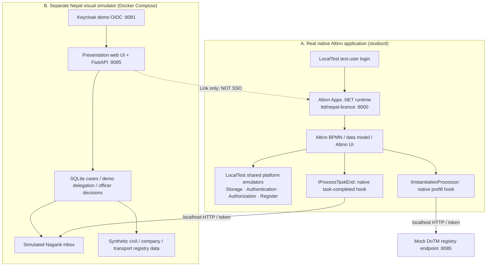
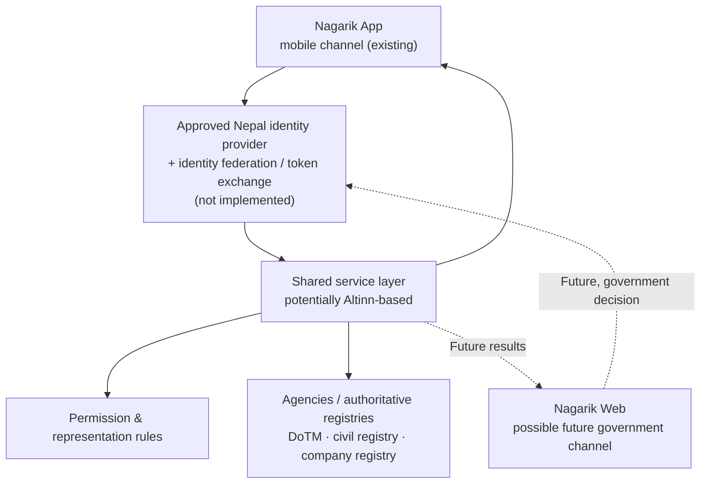

# Architecture: what runs today, and what Nepal could build

The diagrams distinguish **implemented components** from **future options**. This is important: a proposed nationwide platform should not be inferred from a localhost demonstration.

## 1. Current application landscape

**Separate trust domains:** the Keycloak browser session does **not** authenticate users in the native Altinn application. LocalTest users are separate test identities. The synthetic bridge uses an internal demonstration token, not national identity credentials.

**Ports:** native Altinn `local.altinn.cloud:8000`; Nepal presentation `localhost:8085`; Keycloak `localhost:8081`. Running `docker compose up` by itself uses `localhost:8000` for the presentation UI; it cannot share that port with the native Altinn app.

### Implementation map

| Concern | File or service | Reality |
|---|---|---|
| Altinn native app | `native-altinn/nepal-licence/App` | Real Altinn App source, .NET runtime |
| Native application process | `App/config/process/process.bpmn` | Data task + PDF step, not a DoTM officer approval process |
| Native access policy | `App/config/authorization/policy.xml` | XACML with Norwegian LocalTest role codes |
| Native form | `App/ui/form/layouts/Side1.json` and models | Native Altinn UI/layout and binding |
| Registry prefill | `App/logic/NepalRegistryPrefill.cs` | Native hook, synthetic data; HTTP mock when configured |
| Notification callback | `App/logic/NativeNagarikTaskEnd.cs` | Native hook, synthetic event; HTTP mock when configured |
| Local platform | `studioctl env up` | Official LocalTest **emulators**, not production Altinn microservices |
| Nepal browser simulator | `api/static/*`, `api/main.py` | Functional explanatory UI + local business logic |
| Simulator authentication | `identity/nepal-realm.json` | Real OIDC protocol, fabricated users and low/no legal assurance |
| Delegation and officer review | `api/main.py` | Simulator-specific enforcement, **not native Altinn Access Management** |
| Cross-stack bridge | `/api/stubs/dotm/licence` and `/api/integrations/native-altinn/events` | Token-protected localhost demo API |
| Nagarik inbox | `/api/inbox` | Mock only, shown inside presentation web UI |

## 2. Current mobile channel versus future government web channel

The **actual Nagarik App is a mobile product** for public services at the documented stage. A Nepal government procurement scope describes **Nagarik Web** as a desired web-based counterpart. This repository's web UI is merely a desktop/mobile-friendly **presentation simulator**, not an official Nagarik product.

This is a **target-state concept**, not a deployed system. A separate web channel does not require duplicating forms, processes and data repositories if the architecture supports common APIs. It does require browser-safe authentication (for example OIDC authorization code with PKCE), government-approved assurance, security and accessibility; implementation and policy decisions remain with Nepal.

## 3. Data flows in the current demonstration

**Flow A: native Altinn prefill.** A user authenticates with LocalTest and creates an Altinn instance. Altinn calls `IInstantiationProcessor.DataCreation`. The adapter reads a fictional licence reference from the localhost DoTM mock when configured, otherwise returns a static fictional fallback. The app data model receives the reference. This is not an authoritative lookup.

**Flow B: native task event.** When the Altinn data task finishes, `IProcessTaskEnd.End` attempts to send a minimal event containing an app identifier, generated event ID and instance ID to the mock bridge. The bridge requires a token and checks for duplicate IDs, then adds a fictional inbox notification for the fixed test persona Asha. **The notification is not routed by the actual applicant's government identity.** The task-end callback is non-blocking; a failed callback does not stop the native process. This is demonstration behavior, not guaranteed delivery, and the complete browser-based task journey is not yet tested in CI.

**Flow C: simulated business delegation.** Keycloak logs Raj in to the simulator. Raj grants Priya a narrow transport-permit scope in simulator SQLite. Priya authenticates separately and is permitted to submit; after revocation the simulator returns 403. These rights do not exist in the native Altinn authorization service.

**Flow D: simulated agency decision.** Asha submits a fake licence correction through the simulator UI; Maya reviews in the simulator's officer desk; Asha sees a mock inbox message and a demo-only HMAC verification URL. This is not a legal signature or a real DoTM update.

## 4. Security and operations boundaries

- **Ports bind to 127.0.0.1**, not to a public network interface. Do not expose the demonstration directly to the Internet.
- Tokens in the bridge are shared local bearer secrets; they are not OAuth service tokens. `start-all.sh` generates an ephemeral value and passes it to both processes.
- The native Altinn callback verifies only a local host target and token; there is **no production mTLS, agency-issued authentication, trusted webhook signature or queue**.
- The simulator uses a local SQLite database, synthetic identities, hard-coded demo role mappings and well-known credentials.
- Keycloak is launched in development mode, HTTP only, with demonstration passwords. **It is not BankID or a government-accredited eID.**
- The bridge performs no durable retry/outbox delivery; failure is logged and not retried. The inbox assigns events to a sample persona rather than resolving citizens' identity.
- No real personal, company, national-ID or licence data must be submitted.

## 5. Production architecture: decisions not yet made

A real deployment would need to specify:

- approved Nepal identity issuer(s), assurance levels and recovery;
- party, business and legal-representation models;
- actual shared Altinn AuthN/AuthZ/Storage/Access Management services or approved alternatives;
- government information exchange and consent/legal basis per record;
- one service owner per workflow, event delivery guarantees, trace IDs, data residency and backup;
- mobile and potential web clients with consistent API/version contracts;
- monitoring, operations, support, infrastructure and independent security review.

See [identity and channels](IDENTITY_AND_CHANNELS.md), [integration contracts](INTEGRATION_CONTRACTS.md) and [component status](ALTINN_COMPONENT_STATUS.md).

## Sources

- [Altinn local development](https://docs.altinn.studio/en/altinn-studio/v8/guides/development/local-dev/)
- [Altinn landscape](https://docs.altinn.studio/en/technology/architecture/altinn-landscape/)
- [Altinn authentication](https://docs.altinn.studio/en/authorization/getting-started/authentication/)
- [Nepal Nagarik Web procurement scope](https://bolpatra.gov.np/egp/download?alfId=cm%3ABidding_Documentsnull%2Fcm%3AY2021%2Fcm%3AM1%40%40%40%40%40cf6cc693-9187-454a-9bc7-0bcf44d42e3d&docId=66495320), section 3.2.1 (proposal, not proof of a launched web product).
