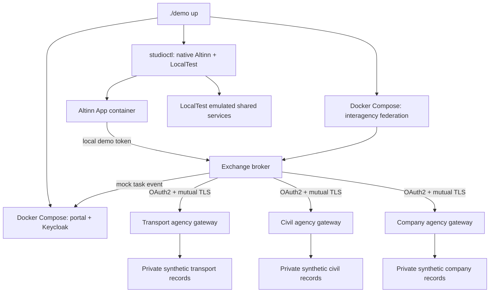

# Running the Altinn–Nepal demonstrator

The default launcher runs the native Altinn sample, its official LocalTest environment, the Nepal presentation portal and the interagency federation example in Docker. It is a **local demonstration**, not a production deployment.

## Requirements

Install Docker Engine or Docker Desktop with Compose v2, Bash, Git and the official [Altinn studioctl preview CLI](https://docs.altinn.studio/en/altinn-studio/v8/guides/development/local-dev/). The host does not need the .NET SDK or a Python installation for the combined demonstration.

```bash
git clone https://github.com/SushantGautam/altinn-example-np.git
cd altinn-example-np
./demo up
./demo status
```

Use `./demo down` when finished. Use `./demo clean --yes` **only** to destroy the synthetic application, agency and exchange audit data. Altinn LocalTest has separate data management.

| Command | Result |
| --- | --- |
| `./demo up` | Start simulator, Keycloak, federation stack and native Altinn LocalTest/application containers |
| `./demo status` | Show containers and Altinn environment status |
| `./demo logs` | Inspect portal, Keycloak, federation and native application logs |
| `./demo down` | Stop services and remove temporary local bridge token; retain data volumes |
| `./demo clean --yes` | Remove simulator, agency registries and broker audit volumes; does not reset LocalTest |

## Local addresses

| Service | Address |
| --- | --- |
| Nepal service presentation | http://localhost:8085 |
| Native Altinn application | http://local.altinn.cloud:8000/ttd/nepal-licence/ |
| Local Keycloak provider | http://localhost:8081 |
| Synthetic interagency exchange dashboard | http://localhost:8090 |

The presentation portal uses fictional Keycloak accounts, including `asha / Demo123!`. The native Altinn application uses **LocalTest identities**, not those Keycloak accounts. There is no cross-system single sign-on. Never use real personal data or government credentials.

## How the environment is assembled



The launcher coordinates **three container environments**, not a single Compose stack:

1. `docker compose` starts the presentation portal, SQLite storage and Keycloak under project `altinn-nepal`.
2. `infra/federation/compose.yml` starts the exchange broker, three agency gateways, three synthetic registries, local certificate initialization and isolated Docker networks under `altinn-federation`.
3. `studioctl env up` starts official Altinn LocalTest emulators. `studioctl run --mode container --detach` builds and runs the genuine `.NET` Altinn application.

The native Altinn app is attached to the presentation network so it can resolve the exchange broker's Docker service name. It does **not** directly join the private agency registry networks.

## Local integration and security boundaries

During startup, the launcher creates `.demo.local.env` with a random 256-bit demo token, with restrictive file permissions. A restricted JSON configuration file is copied to `/tmp/altinn-nepal-bridge.json` inside the native Altinn container.

The native application then sends sample requests to:

- `http://exchange-broker:8000/v1/native/dotm` for synthetic licence prefill.
- `http://exchange-broker:8000/v1/native/events` for a synthetic task-ended event.

The exchange service uses a separate Keycloak machine-identity flow for its agency calls. Agency gateways use certificate-based mutual TLS and signed OAuth2 tokens in the local test environment. Agency record services live on private Docker networks that are not directly published to the host.

The locally generated certificate authority, test clients, service credentials and network boundaries are **examples**, not government-approved PKI, identity assurance, permanent service credentials or national infrastructure. The native application-to-broker token is a demonstration mechanism, not production federated authentication. The synthetic notification does not establish the real applicant's identity and is not guaranteed-delivery messaging.

## Stopping and resetting

`./demo down` stops the Altinn application before removing Compose networks, then stops the federation and presentation projects. It removes the temporary token file but preserves their data volumes.

`./demo clean --yes` stops services and removes volumes belonging to the simulator, the three synthetic registries, the broker's audit store and the local demonstration PKI. **It does not delete Altinn LocalTest's separately owned data.** Consult `studioctl env reset --help` before resetting LocalTest.

Do not use standalone `docker compose up` and the combined launcher at the same time: the standalone portal normally claims port 8000, which conflicts with the native Altinn route.

## Checking the setup

The CI workflows provide complementary checks:

- [Demo checks](../.github/workflows/ci.yml): API tests, OIDC workflow, documentation, repository hygiene and Compose smoke test.
- [All-Docker demonstration](../.github/workflows/containerized-native.yml): combined startup, real Altinn container, local service connectivity, synthetic federation and teardown.
- [Native Altinn checks](../.github/workflows/native-altinn.yml): application model, policy, process and build.

These tests do not yet prove a full browser-driven native form submission through real officer processing and final delivery. Review [component status](ALTINN_COMPONENT_STATUS.md) before representing any particular feature as implemented.

## Troubleshooting

| Symptom | What to check |
| --- | --- |
| `studioctl` not found | Install the official CLI and verify it is on `PATH` |
| Docker unavailable | Start Docker Desktop or Docker Engine |
| Port 8000 already used | Stop standalone simulator or other Altinn LocalTest instances |
| Altinn page unavailable | Run `./demo logs` and `studioctl env status` |
| Federation dashboard missing | Inspect `./demo status` and broker/agency logs |
| Synthetic event not shown | A native task must finish; check app and exchange logs |
| Need a clean demonstration | Run `./demo clean --yes` only after checking data-loss scope |

See the [developer guide](DEVELOPER_GUIDE.md), [architecture](ARCHITECTURE.md) and [integration contracts](INTEGRATION_CONTRACTS.md).
