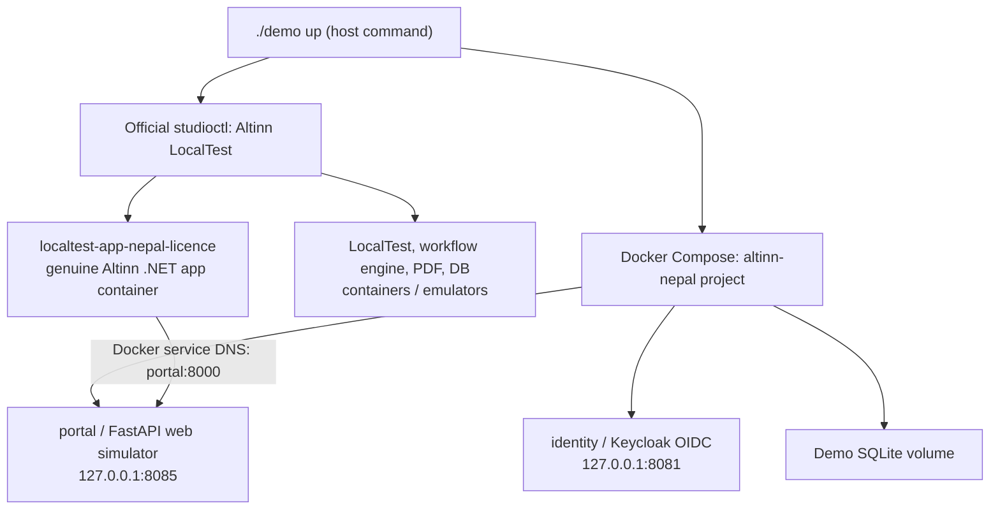

# Docker deployment for the local Nepal × Altinn demonstration

**Everything that serves the local demo now runs in Docker containers**, including the genuine native Altinn .NET application. The **host still needs Docker with Compose v2, Bash and the official `studioctl` CLI**, which orchestrates Altinn's official LocalTest environment. You do **not** need a host .NET SDK or Python runtime.

This is a **developer/presentation deployment**, not a production national Altinn stack. Native app execution is genuine; Storage, Authentication, Authorization and Register/Profile are Altinn LocalTest emulators. Keycloak and the Nepal portal are separate simulated components. Real Nagarik App (mobile), Nepal identity and DoTM systems are not connected.

## Quick start

```bash
git clone https://github.com/SushantGautam/altinn-example-np.git
cd altinn-example-np

# One-time: install official studioctl using its supported installer.
# https://docs.altinn.studio/en/altinn-studio/v8/guides/development/local-dev/

./demo up
```

The `demo` script supports:

| Command | Effect | Deletes records? |
|---|---|---|
| `./demo up` | Builds/starts the portal, Keycloak, official LocalTest and real Altinn App **containers**; joins the native app to a private simulation network | No |
| `./demo status` | Lists demo containers and Altinn LocalTest environment status | No |
| `./demo logs` | Shows recent portal, Keycloak and native app logs | No |
| `./demo down` | Stops all demo app and LocalTest containers; removes the demo Compose network; removes generated bridge token | **No**, volumes remain |
| `./demo clean --yes` | Stops services and removes **only the Nepal simulator Docker volume** | **Yes** for simulator; LocalTest persistence is separate |

The old scripts `bash scripts/start-all.sh` and `bash scripts/stop-all.sh` are retained and call the same launcher. Use `bash scripts/demo.sh up` if execute permissions are not preserved by your checkout. `./demo help` prints command usage.

## URLs

| Service | URL | Credentials |
|---|---|---|
| Genuine Altinn App with LocalTest | http://local.altinn.cloud:8000/ttd/nepal-licence/ | **LocalTest** test-user login |
| Nepal visual **web simulator** | http://localhost:8085 | Fictional Keycloak users, e.g. `asha / Demo123!` |
| Synthetic Keycloak identity provider | http://localhost:8081 | Same fictional accounts; **not** real Nepal eID |

**Nagarik App is mobile-only in the documented current product model.** The browser UI here is for explaining the proposed ecosystem. A future Nagarik Web would be a separate government-owned system with approved authentication, not this simulator.

## What the launcher actually does



Altinn officially supports `studioctl run --mode container --detach`. The CLI builds the app image **inside Docker** and registers it with its LocalTest routing. The local browser URL is unchanged. This has been executed in GitHub Actions without installing a host .NET SDK.

The launcher separately starts `docker compose` (portal and Keycloak) with project `altinn-nepal`, then `studioctl env up` and `studioctl run --mode container --detach`. Altinn's app container is named `localtest-app-nepal-licence`. The launcher attaches that container to the portal's Compose network `altinn-nepal_default`, enabling the native Altinn lifecycle hooks to call the fake transport and inbox APIs.

This is **not a single Docker Compose project**. It is a **single-command orchestration of two official/local Docker environments**. We avoid copying the complex and changeable Altinn LocalTest Compose definitions into this repository.

## Secrets and synthetic network bridge

- The launcher generates `.demo.local.env` with a 256-bit random hex token (stored with restrictive file permissions, ignored by Git).
- Compose gives that token only to the local simulator API process.
- The launcher injects an ephemeral `/tmp/altinn-nepal-bridge.json` into the **running native app container** using Docker CLI, then restricts ownership/permissions to the Altinn app user.
- Native `LocalDemoBridge.cs` reads the file during app lifecycle hooks, rather than baking a secret into the image.
- Native DoTM prefill calls `http://portal:8000/api/stubs/dotm/licence`; native task-ended callback calls `http://portal:8000/api/integrations/native-altinn/events` with the token.
- Demo stubs validate the token and event format; the inbox uses fictional Asha as its recipient. This is not an applicant-identity mapping, national login, or guaranteed message delivery.

The Altinn app and simulator remain **separate identity realms**. A token protected fake connector does not provide SSO. Do not use this file-based demo bridge design as a production service authentication method.

## Teardown, persistence and resource isolation

`./demo down` stops the `studioctl` app **before** `docker compose down`, because the native container temporarily shares the portal's network. This permits the Compose network to be removed cleanly. The script also removes its generated local token file.

The simulator's SQLite data volume persists across `down`; `./demo clean --yes` wipes it. **Altinn LocalTest keeps its own separately managed volumes/data**, which are not removed by the simulator's clean command. Use `studioctl env reset --help` for the official LocalTest reset procedure, and make sure you are not resetting other local Altinn work.

The setup is intended for a single laptop. Do not run `docker compose up` in the default standalone mode simultaneously with Altinn: both would claim host port 8000. The unified launcher relocates the presentation portal to port 8085.

## Why not just `docker compose up`?

The genuine Altinn app needs registration, routing, generated settings, LocalTest platform containers and an image build. The official `studioctl` preview CLI manages these details. Copying or rewriting internal service definitions into this repo would create another unmaintained stack and risk a demo that appears to work while running incompatible emulators.

The practical contract for reviewers is **one command up, one command down, Docker runtime for all applications, official Altinn CLI on the host**. The rest of the ecosystem (BankID/Nepal eID, real Altinn Access Management and national microservices) remains outside this local test stack.

## Verification

The [All-Docker GitHub Actions workflow](../.github/workflows/containerized-native.yml) exercises the real `./demo up` and `./demo down`, checks the Altinn app container and synthetic network bridge, tests the Keycloak OIDC sign-in, and checks that the Compose network is removed.

The [native Altinn build](../.github/workflows/native-altinn.yml) and [simulator API checks](../.github/workflows/ci.yml) provide other evidence. An automated **native browser submission all the way through its BPMN task to a mock inbox message** remains a separate acceptance test.

## Troubleshooting

| Problem | Action |
|---|---|
| `studioctl` missing | Install the CLI using [official docs](https://docs.altinn.studio/en/altinn-studio/v8/guides/development/local-dev/) and make sure it is on PATH |
| Docker daemon not started | Start Docker Desktop/Engine, then `./demo up` |
| Port 8000 already in use | Stop standalone portal containers or other LocalTest instances |
| Native app route unavailable | Inspect `./demo logs` and `studioctl env status`; rebuild via `./demo up` |
| Cannot connect the network | Confirm that Docker allows network connections, and that `altinn-nepal_default` exists |
| Native callback not visible | The native BPMN task must actually end; inspect app logs. This is a best-effort mock event and does not use applicant-to-inbox routing |
| Need clean slate | `./demo clean --yes` wipes only simulator data; use official `studioctl env reset` separately for LocalTest |
| Want to develop C# on the host | Use `studioctl run --mode process` as a developer option; **the default showcase does not need .NET installed** |

**Security:** localhost/laptop-only demo; Keycloak dev credentials, test identities and service-to-service token are not fit for public exposure. Do not use real citizen/agency data.

[Developer guide](DEVELOPER_GUIDE.md) · [Architecture](ARCHITECTURE.md) · [Component status](ALTINN_COMPONENT_STATUS.md).
