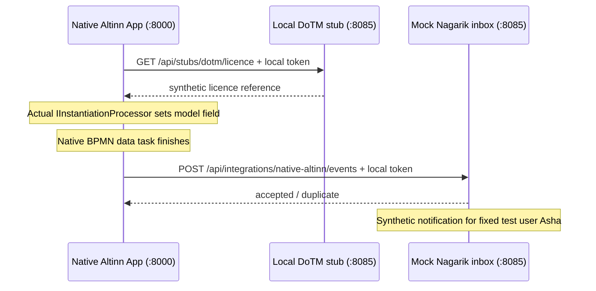

# Integration contracts — implemented local stubs versus future government APIs

**Not official API specifications.** No live Nepal ID, Nagarik mobile app, civil, company or transport department is connected. Sample records and people are fabricated. The local connector uses an ephemeral shared token, **not** a production access token or national authentication service.

## 1. What works in the current repository



The Altinn lifecycle hook code is genuine, and each HTTP endpoint is exercised in local tests. With `./demo up`, the native App container connects to `http://exchange-broker:8000` using a random local token injected into `/tmp/altinn-nepal-bridge.json` after the image is built. The broker handles synthetic agency exchange and forwards eligible test events to the simulator. The direct portal stubs remain useful for isolated contract tests. The combined environment has passed a CI startup/contract smoke test. **A browser-driven native Altinn application being submitted through its task and delivering a notification has not yet been automated in CI.** The mock inbox is not an actual Nagarik channel.

### Native prefill stub (implemented)

```http
GET http://127.0.0.1:8085/api/stubs/dotm/licence
X-Native-Demo-Token: <local-ephemeral-token>
```

```json
{"reference":"DL-NP-SYNTHETIC-001","source":"DoTM HTTP registry stub (synthetic)"}
```

- Returns `403` if the token is missing or wrong; returns `404` if not in demo mode.
- Called by `INepalRegistryClient` from Altinn's `IInstantiationProcessor` when `DOTM_MOCK_REGISTRY_URL` is set.
- If the optional endpoint is unavailable, the native adapter returns a clearly synthetic fallback. This permissive fallback is **not** an acceptable production decision for critical government data.

### Native task-ended event bridge (implemented)

```http
POST http://127.0.0.1:8085/api/integrations/native-altinn/events
Content-Type: application/json
X-Native-Demo-Token: <local-ephemeral-token>
```

```json
{
  "source": "ttd/nepal-licence",
  "event_type": "native.altinn.task.completed",
  "event_id": "native.ci.bridge.Task_1",
  "instance_id": "CI-TEST/1234567890"
}
```

Successful reply:

```json
{"accepted": true, "duplicate": false}
```

Resending the same `event_id` returns `{"accepted":true,"duplicate":true}` without adding another message. The server validates the token, fixed source/type and event/reference syntax. It logs a demo event and sends a **mock inbox message to the fixed fictional Asha account**. It does **not** map Altinn's real applicant to a Nagarik recipient.

The native sender uses `IProcessTaskEnd` for `Task_1`. Failure to send is logged and does not halt processing; there is no outbox/queue/retry or guaranteed delivery.

### Simulator APIs (implemented, not native Altinn)

| Area | Paths | Restrictions |
|---|---|---|
| Demo identity | `/auth/login`, `/auth/callback`, `/api/me` | Keycloak synthetic OIDC; server session |
| Civil / transport fixture | `GET /api/registries/me` | Citizen session; fabricated resident/licence records |
| Company fixture | `GET /api/registries/company` | Director/accountant/officer role; accountant requires current delegation |
| Cases | `GET/POST /api/cases` | Role + case ownership + CSRF for writes |
| Officer decision | `PATCH /api/cases/{case_id}/decision` | Officer-only; demo states approved/rejected/needs-info |
| Representation | `GET/POST /api/delegations`, `DELETE /api/delegations/{id}` | Director grant/revoke, accountant scoped access |
| Citizen inbox | `GET /api/inbox` | Current simulator user; not live Nagarik |
| Oversight | `GET /api/audit`, `GET /api/metrics` | Audit restricted to officer/observer; fake counts only |
| Verification | `GET /api/verify/{case_id}?proof=...` | Demo HMAC, **not legal e-signature** |
| Reset | `POST /api/demo/reset` | Observer and demonstration mode only |

OpenAPI for the **simulator**, not national Altinn: `http://localhost:8085/api/docs` when combined. Actual endpoint implementations: `api/main.py`, `api/connectors.py`; native hooks: `App/logic/`.

## 2. Proposed future Nepal adapters (NOT implemented)

| Owner / system | Possible contract to agree | Critical dependencies |
|---|---|---|
| Approved Nepal identity provider | OIDC issuer, JWKS, assurance levels, stable opaque user identifier | Government-issued trust, security, recovery, legal recognition |
| Authoritative civil registry | Minimal read-only record lookup via authenticated service/API | Legal purpose, consent where applicable, traceable requests |
| Company registry | Party and legal-representative mapping, grant source and revocation | Verified signatory powers and national business identifiers |
| Department of Transport Management | Licence record lookup, case processing, updates and status callbacks | DoTM ownership, non-repudiation, idempotency, audit |
| Nagarik **mobile** channel | Notification, service launch, case status via approved interfaces | Government channel ownership, recipient mapping, user privacy |
| Potential future **Nagarik Web** | Same underlying services with browser-safe authentication | Government decision, supported issuer, UI/identity security, accessibility |
| Native Altinn Authorization / Storage | Full service integration into real shared components | National party/role model, platform operations, policy review |

### Example identity claim (concept only)

```json
{
  "sub": "opaque-government-subject",
  "iss": "https://identity.example.gov.np",
  "aud": "approved-service-client",
  "acr": "government-approved-assurance"
}
```

The `example.gov.np` hostname is documentation only; no claim is made that it exists or is approved.

### Example future agency record (concept only)

```json
{
  "licenceReference": "SYNTHETIC-NP-123",
  "holder": "opaque-authorized-party-ref",
  "status": "verified",
  "source": "approved-transport-registry",
  "checkedAt": "2026-11-17T10:00:00Z"
}
```

In production, field names, data types, query permissions and audit obligations must be negotiated with agency owners. **Do not assume Nepal already exposes these endpoints.**

## 3. Production quality bar for connectors

- Authenticate both user **and** calling service, validate issuer/audience/scope/assurance, and authorize every requested field and operation.
- Preserve agency system-of-record ownership. Require purpose limitation and disclose only necessary data.
- Prohibit client-supplied identity claims as trusted party identifiers.
- Map delegated rights only from verified company/party authority; enforce revocation immediately in backends.
- Use approved TLS/mTLS or equivalent cryptographic service authentication, short-lived credentials, rotation and safe key storage.
- Introduce correlation IDs, durable outbox/retry, idempotency keys, dead-letter queues, reconciliation, fault injection and monitoring.
- Prevent silent fallbacks from real-identity or real-licence verification to synthetic data.
- Define residency, retention/deletion, consent/legal basis, accessible alternatives and oversight.

## 4. Integration test checklist

- Valid citizen identity and registry permission yields only legally authorized fields.
- Invalid/wrong-scope/expired identity yields an auditable denial.
- A representative cannot use company credentials or scope without recorded authorization; revocation blocks access.
- Agency service update generates a durable event and an authorized notification to the correct person.
- Network outages do not cause accidental approval or lost submissions.
- A future web client and current mobile client use the **same server-side service permissions**.
- Native Altinn test covers **actual user → form → BPMN transition → callback → inbox**, in addition to endpoint-level checks.

[Architecture](ARCHITECTURE.md) · [Developer guide](DEVELOPER_GUIDE.md) · [Identity and channels](IDENTITY_AND_CHANNELS.md).

## All-Docker bridge

The default `./demo up` runs real Altinn and the separate Nepal simulator as containers, using `studioctl --mode container` plus Docker Compose. Native lifecycle hooks connect to the synthetic exchange broker through Docker service DNS `exchange-broker:8000` using `/v1/native/dotm` and `/v1/native/events`. The browser accesses the portal on `localhost:8085`, and a separate federation dashboard is available on `localhost:8090`. A random demo secret is placed in a restricted file inside the running native app container. This is a **local synthetic protocol**, not authenticated government API access, cross-realm identity federation or guaranteed message delivery. See [Docker operations](DOCKER.md).
